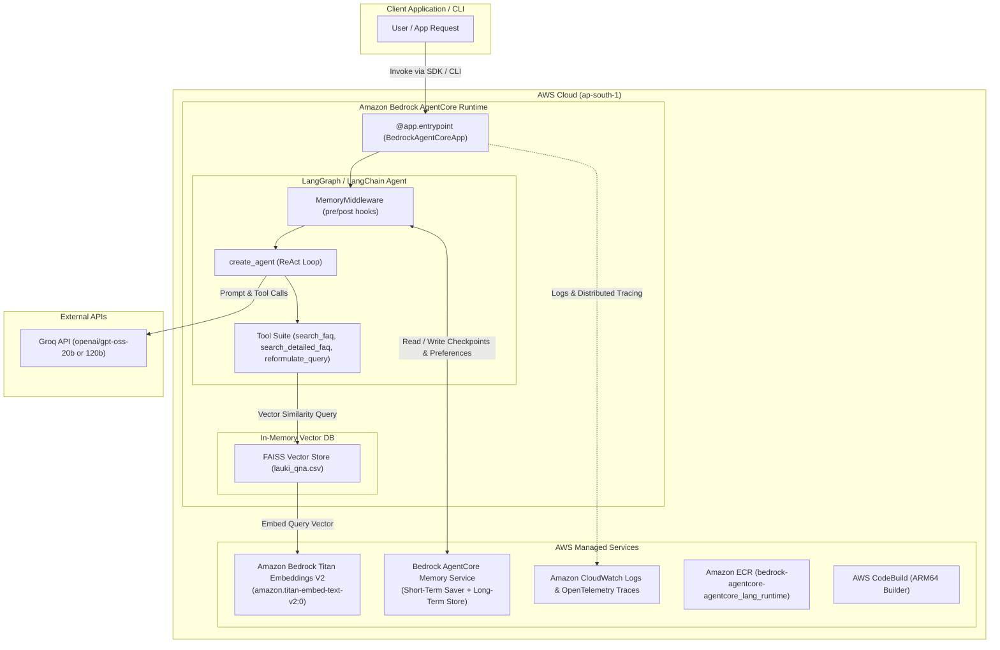
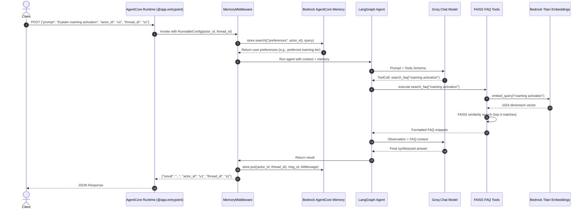
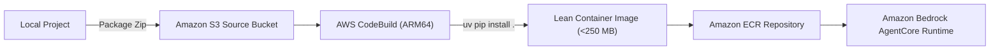

# Lauki FAQ Assistant on Amazon Bedrock AgentCore

A production-grade, retrieval-augmented conversational agent built with **LangGraph**, **LangChain**, **Groq LLMs**, **Amazon Bedrock Titan Embeddings**, and **Amazon Bedrock AgentCore Runtime**.

This repository demonstrates the progressive evolution of an intelligent telecom customer-support assistant:
1. **Local Agent Baseline (`00_langgraph_agent.py`)**: Standalone LangGraph agent using FAISS vector search, multi-tool retrieval, and Groq LLM inference.
2. **Cloud-Deployed AgentCore Runtime (`01_agentcore_runtime.py`)**: Stateless containerized agent deployed to the Amazon Bedrock AgentCore managed serverless runtime.
3. **Stateful Agent with AgentCore Memory (`02_agentcore_memory.py`)**: Advanced runtime leveraging `langgraph-checkpoint-aws` for thread-level session checkpoints and long-term user preference memory.

---

## Table of Contents

- [Project Overview](#project-overview)
- [Key Features](#key-features)
- [Architecture and System Design](#architecture-and-system-design)
  - [High-Level Architecture](#high-level-architecture)
  - [Invocation Sequence Diagram](#invocation-sequence-diagram)
- [Technology Stack](#technology-stack)
- [Repository Structure](#repository-structure)
- [Prerequisites](#prerequisites)
- [Installation and Setup](#installation-and-setup)
- [Environment Variables and Configuration](#environment-variables-and-configuration)
- [How to Run the Project](#how-to-run-the-project)
  - [1. Running Locally (Baseline)](#1-running-locally-baseline)
  - [2. Testing Runtime Entrypoints Locally](#2-testing-runtime-entrypoints-locally)
  - [3. Deploying to Amazon Bedrock AgentCore](#3-deploying-to-amazon-bedrock-agentcore)
  - [4. Invoking the Deployed Cloud Agent](#4-invoking-the-deployed-cloud-agent)
- [Usage Examples](#usage-examples)
- [Detailed Implementation Walkthrough](#detailed-implementation-walkthrough)
  - [RAG Ingestion and Vector Search Pipeline](#rag-ingestion-and-vector-search-pipeline)
  - [Tool Suite](#tool-suite)
  - [Agent Orchestration (LangGraph & LangChain)](#agent-orchestration-langgraph--langchain)
  - [Memory Architecture (02_agentcore_memory.py)](#memory-architecture-02_agentcore_memorypy)
- [Testing and Validation](#testing-and-validation)
- [Deployment Guide](#deployment-guide)
  - [CloudBuild Container Pipeline](#cloudbuild-container-pipeline)
  - [Switching Entrypoints (01 vs 02)](#switching-entrypoints-01-vs-02)
  - [Resource Teardown (Avoiding Unintended Charges)](#resource-teardown-avoiding-unintended-charges)
- [Security and Privacy](#security-and-privacy)
- [Performance, Scalability, and Cost](#performance-scalability-and-cost)
- [Troubleshooting and FAQ](#troubleshooting-and-faq)
- [Limitations and Future Improvements](#limitations-and-future-improvements)
- [Contributing Guide](#contributing-guide)
- [License and Acknowledgments](#license-and-acknowledgments)
- [Documentation Maintenance](#documentation-maintenance)

---

## Project Overview

Organizations building AI customer support assistants face two major production hurdles:
1. **Packaging & Image Size Constraints**: Traditional local embedding libraries (such as `sentence-transformers` and PyTorch) bloat container images to 3.5+ GB, exceeding managed serverless container limits (e.g., Bedrock AgentCore's 2.0 GB quota).
2. **Session & Preference Persistence**: Chatbots typically lose context when sessions end or require external databases (Redis, DynamoDB) with complex custom schemas.

This project solves both challenges:
- **Ultralight Cloud Embedding Pipeline**: Offloads vector embeddings to **Amazon Titan Text Embeddings V2** (`amazon.titan-embed-text-v2:0`) via `langchain-aws`. This keeps the production container image under **250 MB** (a >90% reduction from PyTorch images), eliminating quota failures and enabling sub-minute cold starts.
- **Native Managed AgentCore Memory**: Integrates `AgentCoreMemorySaver` and `AgentCoreMemoryStore` from `langgraph-checkpoint-aws` to maintain short-term thread state and cross-session user preferences without provisioning external databases.
- **High-Speed Inference**: Connects to **Groq** (`ChatGroq`) for high-throughput, low-latency agent reasoning with Llama/GPT-OSS model families.

---

## Key Features

- **Progressive Architecture**: Clear separation between local prototyping (`00`), serverless cloud deployment (`01`), and stateful conversational memory (`02`).
- **Semantic Domain FAQ Search**: FAISS in-memory vector store indexing 76 curated Q&A pairs for the fictitious telecom provider "Lauki Phones".
- **Dynamic Retrieval Tools**:
  - `search_faq`: Standard similarity retrieval ($k=3$).
  - `search_detailed_faq`: Broader context retrieval ($k=5$) for complex multi-part queries.
  - `reformulate_query`: Aspect-targeted query expansion (e.g., pricing, activation, troubleshooting).
- **Amazon Bedrock AgentCore Native**:
  - Uses `BedrockAgentCoreApp` lifecycle hooks (`@app.entrypoint`).
  - Containerized with ARM64 Debian-slim base image and `uv` package manager.
  - Native AWS OpenTelemetry (`aws-opentelemetry-distro`) telemetry integration.
- **Two-Tier Conversational Memory**:
  - **Thread-Level Checkpoints**: Short-term conversational state preserved across turns via `AgentCoreMemorySaver`.
  - **Actor-Level Long-Term Store**: Cross-thread preferences stored and queried via `AgentCoreMemoryStore` and `MemoryMiddleware`.

---

## Architecture and System Design

### High-Level Architecture



### Invocation Sequence Diagram



---

## Technology Stack

| Layer / Dependency | Purpose | Implementation Details |
| :--- | :--- | :--- |
| **Python 3.13** | Core language runtime | Specified in `pyproject.toml` (`requires-python = ">=3.13"`) and Docker base image. |
| **uv** | Fast Python package & dependency manager | Used locally for locking (`uv lock`), syncing (`uv sync`), and container installs (`uv pip install`). |
| **Amazon Bedrock AgentCore** (`bedrock-agentcore`) | Managed serverless execution environment | `BedrockAgentCoreApp` hosts HTTP microservices conforming to AWS AgentCore protocol on port 8080/9000. |
| **AgentCore Toolkit** (`bedrock-agentcore-starter-toolkit`) | Cloud build, deploy, invoke, and teardown CLI | Orchestrates S3 uploads, CodeBuild projects, ECR pushes, and runtime registrations. |
| **LangGraph** (`langgraph`) | State machine and conversational graph orchestrator | Compiles agent workflows with checkpointer and store interfaces. |
| **LangChain Core & Community** (`langchain`, `langchain-community`) | Agent abstraction & utility components | Agent runtime (`create_agent`), document models (`Document`), and CSV loaders. |
| **LangChain AWS** (`langchain-aws`) | Bedrock embedding integration | `BedrockEmbeddings` invoking `amazon.titan-embed-text-v2:0` in `ap-south-1`. |
| **LangChain Groq** (`langchain-groq`) | LLM model interface | Connects to Groq inference engine (`ChatGroq`) for Llama/GPT-OSS models. |
| **LangGraph Checkpoint AWS** (`langgraph-checkpoint-aws`) | Persistent cloud agent memory | `AgentCoreMemorySaver` (short-term) and `AgentCoreMemoryStore` (long-term). |
| **FAISS CPU** (`faiss-cpu`) | Dense vector similarity search index | In-memory index constructed from `lauki_qna.csv` chunks via `FAISS.from_documents`. |
| **Docker / AWS CodeBuild** | Cloud containerization & build system | ARM64 Debian-slim container built in AWS CodeBuild and hosted on Amazon ECR. |
| **AWS OpenTelemetry** (`aws-opentelemetry-distro`) | Observability & distributed tracing | Instrumenting agent container with CloudWatch GenAI observability. |

---

## Repository Structure

```text
c:/Users/sujat/projects/AWS/Bedrock/AgentCore-Prj-1/
├── .bedrock_agentcore/
│   └── agentcore_lang_runtime/
│       └── Dockerfile             # Multi-stage ARM64 Dockerfile for AgentCore runtime
├── .bedrock_agentcore.yaml        # AgentCore deployment configuration metadata
├── .dockerignore                  # Docker build context exclusion rules
├── .env                           # Local environment variables (git-ignored)
├── .gitignore                     # Git exclusion rules
├── .sample_env                    # Environment template with required variable keys
├── 00_langgraph_agent.py          # Baseline local LangGraph agent (standalone)
├── 01_agentcore_runtime.py        # Stateless cloud AgentCore entrypoint wrapper
├── 02_agentcore_memory.py         # Stateful AgentCore entrypoint with AgentCore Memory
├── lauki_qna.csv                  # Domain dataset (76 Lauki Phones FAQ entries)
├── pyproject.toml                 # Project metadata and locked dependency definitions
├── README.md                      # Comprehensive project documentation
└── uv.lock                        # Deterministic, platform-independent lockfile
```

---

## Prerequisites

### 1. Software Tools
- **Python**: Version 3.13 or newer.
- **uv**: Modern, high-speed Python package manager ([Astral uv](https://github.com/astral-sh/uv)).
- **AWS CLI v2**: Configured with credentials and default region.
- **Git**: For version control.

### 2. External Cloud Accounts and Services
- **AWS Account**:
  - Permissions to access **Amazon Bedrock**, **Amazon ECR**, **AWS CodeBuild**, **Amazon S3**, **AWS CloudWatch**, and **AWS IAM**.
  - **Bedrock Model Access**: Ensure model access is enabled for `amazon.titan-embed-text-v2:0` in the target region (e.g., `ap-south-1` or `us-east-1`).
- **Groq Cloud Account**:
  - Valid Groq API key generated from [Groq Console](https://console.groq.com/).

---

## Installation and Setup

### 1. Clone & Navigate

```bash
git clone <repository-url>
cd AgentCore-Prj-1
```

### 2. Set Up Virtual Environment with `uv`

Using `uv`, you can create and sync the exact dependency tree:

```powershell
# Windows PowerShell
uv venv
.\.venv\Scripts\activate
uv sync
```

```bash
# macOS / Linux
uv venv
source .venv/bin/activate
uv sync
```

### 3. Configure Environment Variables

Copy the template file to `.env`:

```powershell
# Windows PowerShell
Copy-Item .sample_env .env
```

```bash
# macOS / Linux
cp .sample_env .env
```

Edit `.env` and fill in your keys:

```env
GROQ_API_KEY=gsk_your_actual_groq_api_key_here
AWS_DEFAULT_REGION=ap-south-1
```

### 4. Configure AWS Credentials

Ensure your AWS CLI has active credentials:

```bash
aws sts get-caller-identity
```

---

## Environment Variables and Configuration

| Variable | Required? | Purpose | Default / Example | Where Configured |
| :--- | :--- | :--- | :--- | :--- |
| `GROQ_API_KEY` | **Yes** | Authentication token for Groq API LLM inference | `gsk_...` | Local `.env` or `--env GROQ_API_KEY=...` during `agentcore deploy` |
| `AWS_DEFAULT_REGION` | **Yes** | AWS region for Bedrock embeddings and runtime hosting | `ap-south-1` | Local environment, `.env`, or AWS credentials |
| `HF_TOKEN` | *Optional* | Legacy Hugging Face token (not needed for Titan embeddings) | `hf_...` | `.sample_env` |
| `AGENTCORE_SUPPRESS_RECOMMENDATION` | *Optional* | Silences toolkit recommendation notices | `1` | Shell environment variable |

---

## How to Run the Project

### 1. Running Locally (Baseline)

Run `00_langgraph_agent.py` directly to test the FAQ vector search, tool calling, and Groq inference without cloud deployment:

```powershell
uv run python 00_langgraph_agent.py
```

**Expected output:**
The agent will execute a query for `"Explain roaming activation."`, invoke the `search_faq` tool against the FAISS vector database embedded via Amazon Titan, and print the synthesized response directly in the terminal.

### 2. Testing Runtime Entrypoints Locally

You can verify that the runtime entrypoint scripts compile and initialize all AWS and vector components:

```powershell
uv run python -c "import importlib; importlib.import_module('01_agentcore_runtime'); print('01 OK')"
uv run python -c "import importlib; importlib.import_module('02_agentcore_memory'); print('02 OK')"
```

### 3. Deploying to Amazon Bedrock AgentCore

To deploy the containerized runtime (`01_agentcore_runtime.py`) to AWS:

```powershell
agentcore deploy --env GROQ_API_KEY=gsk_your_groq_api_key_here
```

**What happens during deployment:**
1. Code and dependencies are packaged and zipped to S3 (`source.zip`, ~200 KB).
2. AWS CodeBuild spins up an ARM64 builder environment.
3. Docker image is built using `ghcr.io/astral-sh/uv:python3.13-bookworm-slim`.
4. Dependencies are installed (`~250 MB` total image size).
5. The image is tagged and pushed to Amazon ECR.
6. Bedrock AgentCore creates or updates the managed runtime endpoint.

### 4. Invoking the Deployed Cloud Agent

Once deployed, invoke your agent endpoint using the toolkit CLI:

```powershell
agentcore invoke "{'prompt':'tell me about roaming activations'}"
```

**Expected Response:**
```json
{
  "result": "To activate international roaming on Lauki Phones, purchase a region-specific roaming pack (available for APAC, EU, Middle East, and Americas) through the app or portal, then enable data roaming in your device settings. Credentials are automatically provisioned to the visited network."
}
```

---

## Usage Examples

### Direct Python Invocation (00_langgraph_agent.py)

```python
from 00_langgraph_agent import agent

response = agent.invoke({
    "messages": [("human", "What is the policy for replacing a lost SIM card?")]
})
print(response["messages"][-1].content)
```

### Stateful Memory Invocation (02_agentcore_memory.py)

When sending payloads to `02_agentcore_memory.py`, include `actor_id` and `thread_id`:

```json
{
  "prompt": "I frequently travel to France for business. What pack should I get?",
  "actor_id": "corporate-user-8842",
  "thread_id": "session-oct-2026-01"
}
```

The agent saves the user's travel destination to long-term memory under `("preferences", "corporate-user-8842")`. In subsequent sessions:

```json
{
  "prompt": "Remind me what roaming pack I need before my flight tomorrow?",
  "actor_id": "corporate-user-8842",
  "thread_id": "session-nov-2026-02"
}
```

The middleware's `pre_model_hook` automatically retrieves the previous European travel preference from long-term memory and personalizes the answer without the user re-specifying the country.

---

## Detailed Implementation Walkthrough

### RAG Ingestion and Vector Search Pipeline

1. **Document Loading**:
   - `load_faq_csv(path)` parses `lauki_qna.csv`.
   - Each entry is converted to a LangChain `Document`:
     ```python
     Document(page_content=f"Q: {row['question']}\nA: {row['answer']}")
     ```
2. **Text Chunking**:
   - `RecursiveCharacterTextSplitter(chunk_size=500, chunk_overlap=0)` chunks the text. Because Q&A pairs are succinct, each pair remains an atomic retrieval unit.
3. **Embeddings**:
   - `BedrockEmbeddings(model_id="amazon.titan-embed-text-v2:0", region_name="ap-south-1")` generates 1024-dimensional normalized vector embeddings using AWS Bedrock.
4. **Vector Index**:
   - `FAISS.from_documents(chunks, emb)` creates an in-memory dense vector index loaded directly upon module initialization.

### Tool Suite

The agent is equipped with three distinct tools:

```python
@tool
def search_faq(query: str) -> str:
    """Standard search returning top-3 similarity matches."""
    results = store.similarity_search(query, k=3)
    ...

@tool
def search_detailed_faq(query: str, num_results: int = 5) -> str:
    """Broader search returning top-5 similarity matches for multi-part queries."""
    results = store.similarity_search(query, k=num_results)
    ...

@tool
def reformulate_query(original_query: str, focus_aspect: str) -> str:
    """Reformulates the search query focusing on specific aspects (e.g. 'pricing', 'troubleshooting')."""
    reformulated = f"{focus_aspect} related to {original_query}"
    results = store.similarity_search(reformulated, k=3)
    ...
```

### Agent Orchestration (LangGraph & LangChain)

The agent is compiled using `create_agent` from `langchain.agents`:
- **Model**: `ChatGroq(model="openai/gpt-oss-20b", temperature=0)` or `120b`.
- **System Prompt**: Instructs the model to check FAQs first, reformulate queries when needed, and synthesize facts accurately without hallucinating policies.
- **Cycle**: The LLM evaluates the query, triggers one or more tool calls, inspects the retrieved context, and generates the final user-facing response.

### Memory Architecture (`02_agentcore_memory.py`)

- **Short-Term Checkpointing (`AgentCoreMemorySaver`)**:
  - Connects to AWS Bedrock AgentCore Memory with `memory_id="agentcore_memory-aYNFqw3L9O"`.
  - Serializes graph state and message history on every step for a given `thread_id`.
- **Long-Term Preference Store (`AgentCoreMemoryStore`)**:
  - Implements LangGraph's `BaseStore` interface.
  - Allows hierarchical namespaces, specifically `("preferences", actor_id)`.
- **Middleware Hooks (`MemoryMiddleware`)**:
  - `pre_model_hook`: Extracts human messages and uses `store.search()` to retrieve actor preferences, printing or injecting them into context.
  - `post_model_hook`: Intercepts `AIMessage` responses and commits them to the memory store under `(actor_id, thread_id)`.

---

## Testing and Validation

### Validation Checks Performed

| Component | Test Executed | Command | Result | Notes |
| :--- | :--- | :--- | :--- | :--- |
| **Bedrock Titan Embeddings** | Query embedding dimension test | `uv run python -c "from langchain_aws import BedrockEmbeddings..."` | **PASSED** (Output: `1024`) | Verified AWS credentials & Bedrock Titan model access in `ap-south-1`. |
| **00 Baseline Agent** | End-to-end execution | `uv run python 00_langgraph_agent.py` | **PASSED** | Verified FAISS index, tool calling, and Groq inference. |
| **01 Runtime Import** | Module import & index build | `uv run python -c "import importlib; importlib.import_module('01_agentcore_runtime')"` | **PASSED** (Output: `SUCCESS`) | Verified `BedrockAgentCoreApp` and clean dependencies. |
| **02 Memory Import** | Memory client & middleware init | `uv run python -c "import importlib; importlib.import_module('02_agentcore_memory')"` | **PASSED** (Output: `02 OK`) | Verified `AgentCoreMemorySaver` and `AgentCoreMemoryStore`. |
| **Cloud Deployment** | CodeBuild build & AgentCore launch | `agentcore deploy --env GROQ_API_KEY=...` | **PASSED** (Exit code `0`) | Successfully deployed to `arn:aws:bedrock-agentcore:ap-south-1:...`. |
| **Cloud Invocation** | Endpoint invocation | `agentcore invoke "{'prompt':'...'}"` | **PASSED** (Exit code `0`) | Returned accurate Lauki Phones FAQ answer from cloud. |

---

## Deployment Guide

### CloudBuild Container Pipeline

The deployment process uses AWS CodeBuild to compile an ARM64 Linux container without requiring local Docker:



### Switching Entrypoints (01 vs 02)

To deploy the stateful memory runtime (`02_agentcore_memory.py`) instead of the stateless runtime (`01_agentcore_runtime.py`):

1. Reconfigure the entrypoint:
   ```powershell
   agentcore configure -e 02_agentcore_memory.py
   ```
2. Re-deploy passing your Groq API key:
   ```powershell
   agentcore deploy --env GROQ_API_KEY=gsk_your_groq_api_key_here
   ```

### Resource Teardown (Avoiding Unintended Charges)

When you are finished testing, execute these steps to completely tear down all provisioned cloud resources:

#### Step 1: Destroy the AgentCore Runtime & Core Infrastructure
```powershell
uv run agentcore destroy --delete-ecr-repo --force
```
This automatically deletes:
- Bedrock AgentCore runtime endpoint
- ECR repository and all stored container images
- CodeBuild project
- S3 source deployment bundle (`source.zip`)
- Associated IAM execution roles

#### Step 2: Delete Bedrock AgentCore Memory Resource (if created in Lesson 02)
```powershell
uv run agentcore memory delete agentcore_memory-aYNFqw3L9O
```
*(Or delete directly in AWS Console: Amazon Bedrock > AgentCore > Memory).*

#### Step 3: Delete CloudWatch Log Groups
```powershell
aws logs delete-log-group --log-group-name "/aws/bedrock-agentcore/runtimes/agentcore_lang_runtime-QWTlQ5AlSi-DEFAULT" --region ap-south-1
aws logs delete-log-group --log-group-name "/aws/codebuild/bedrock-agentcore-agentcore_lang_runtime-builder" --region ap-south-1
```

#### Step 4: Delete the CodeBuild Source S3 Bucket
```powershell
aws s3 rb s3://bedrock-agentcore-codebuild-sources-114757334131-ap-south-1 --force --region ap-south-1
```

---

## Security and Privacy

- **Credential Separation**: Secret keys (`GROQ_API_KEY`) and AWS credentials must never be committed to source control. `.env` and `.env.*` are excluded via [.gitignore](file:///c:/Users/sujat/projects/AWS/Bedrock/AgentCore-Prj-1/.gitignore).
- **IAM Least Privilege**: The AgentCore execution role requires only:
  - `bedrock:InvokeModel` for `amazon.titan-embed-text-v2:0`.
  - `bedrock-agentcore:*` for memory management (when using Lesson 02).
  - CloudWatch Logs write permissions.
- **Container Isolation**: The Docker container creates and executes under a non-root system user (`bedrock_agentcore`, UID `1000`).
- **Prompt Injection Defense**: System prompts strictly constrain model behavior to answer exclusively based on retrieved context and to acknowledge missing information rather than hallucinating external facts.

---

## Performance, Scalability, and Cost

### Performance & Latency
- **Embedding Latency**: Titan Text Embeddings V2 averages ~50–120ms per query in `ap-south-1`.
- **Vector Search**: FAISS in-memory search over 76 chunks takes <1ms.
- **LLM Generation**: Groq LPU inference averages ~200–500 tokens/second, yielding end-to-end response times under 1 second.

### Container Sizing Comparison

| Embedding Implementation | Resulting ECR Image Size | Bedrock AgentCore Quota (2.0 GB) | CodeBuild Duration |
| :--- | :--- | :--- | :--- |
| **PyTorch / SentenceTransformers** | **3.52 GB** | ❌ **FAILED** (`ServiceQuotaExceededException`) | ~5 minutes |
| **Amazon Bedrock Titan V2 (Current)** | **~250 MB** | ✅ **PASSED** (Sub-quota) | ~50 seconds |

### Estimated Cost Factors
- **Amazon Bedrock AgentCore Runtime**: Pay-per-use compute based on invocation duration and allocated memory.
- **Amazon Bedrock Titan Embeddings**: $0.00002 per 1,000 input tokens.
- **Amazon ECR Storage**: $0.10 per GB-month (reduced to negligible cost with ~250 MB image size).
- **AWS CodeBuild**: Charged per build minute (ARM64 general1.small rate).
- **Groq API**: Usage-based per token pricing (free tier available for experimentation).

---

## Troubleshooting and FAQ

### 1. `ServiceQuotaExceededException: maxImageSizeMb limit exceeded`
- **Symptom**: Cloud deployment fails with `maxImageSizeMb limit exceeded for account...`.
- **Cause**: Container image in ECR exceeded Bedrock AgentCore's 2048 MB (2 GB) ceiling. This happens when libraries such as `torch`, `sentence-transformers`, or CUDA dependencies are installed.
- **Fix**: Remove PyTorch/HuggingFace dependencies from `pyproject.toml` and utilize `langchain-aws` with `BedrockEmbeddings` (Titan Text V2).

### 2. `ModuleNotFoundError: No module named 'langchain'`
- **Symptom**: Container builds successfully in CodeBuild but fails at runtime with `ModuleNotFoundError: No module named 'langchain'`.
- **Cause**: `01_agentcore_runtime.py` imports `from langchain.agents import create_agent`, but only `langchain-aws` and `langchain-community` were declared in `pyproject.toml`.
- **Fix**: Ensure `"langchain>=0.3.0"` is explicitly included in `pyproject.toml` dependencies and synced with `uv lock`.

### 3. `error: unknown command 'launch'`
- **Symptom**: Running `agentcore launch` outputs `error: unknown command 'launch'`.
- **Cause**: Name collision between the new Node.js CLI (`@aws/agentcore`, version 0.31.x) and the Python starter toolkit (`bedrock-agentcore-starter-toolkit`). In newer versions of the Python starter toolkit, `launch` was unified into `deploy`.
- **Fix**: Use `agentcore deploy` or invoke explicitly through the Python environment: `uv run agentcore deploy`.

### 4. `UnicodeEncodeError: 'charmap' codec can't encode character...`
- **Symptom**: Python CLI crashes on Windows with charmap encoding errors when printing emojis.
- **Cause**: Windows console defaults to legacy `cp1252` encoding rather than UTF-8.
- **Fix**: Set `$env:PYTHONIOENCODING="utf-8"` in PowerShell prior to invoking CLI commands, or use modern Windows Terminal.

---

## Limitations and Future Improvements

### Current Limitations
- **In-Memory Vector Store**: The FAISS index is recomputed in memory on each container start. For datasets larger than thousands of records, an external vector database (such as Amazon OpenSearch Serverless or Amazon Aurora PostgreSQL with pgvector) is recommended.
- **Single Tenant Long-Term Memory**: The memory implementation in `02_agentcore_memory.py` is configured for demonstration with single `actor_id` namespaces.

### Recommended Enhancements
- [ ] Migrate the vector store from local FAISS to an **Amazon Bedrock Knowledge Base** backed by OpenSearch Serverless.
- [ ] Add automated evaluation metrics using the `agentcore eval` command.
- [ ] Add streaming responses via `BedrockAgentCoreApp` response stream handlers.

---

## Contributing Guide

1. Fork or clone the repository.
2. Create a feature branch:
   ```bash
   git checkout -b feature/new-tool
   ```
3. Ensure dependencies are locked with `uv lock`.
4. Validate changes locally with `uv run python 00_langgraph_agent.py`.
5. Submit a pull request with descriptive release notes.

---

## License and Acknowledgments

- **License**: Not specified. Please consult the project owner for licensing terms before commercial redistribution.
- **Acknowledgments**:
  - Developed using [Amazon Bedrock AgentCore](https://aws.amazon.com/bedrock/).
  - Powered by [LangGraph](https://github.com/langchain-ai/langgraph) and [LangChain](https://github.com/langchain-ai/langchain).
  - High-speed inference provided by [Groq](https://groq.com/).

---

## Documentation Maintenance

When updating this codebase, keep these related files in sync:
- **Dependencies**: Any package additions/removals must be made in `pyproject.toml` and updated via `uv lock`.
- **Agent Entrypoints**: If creating new modules (e.g., `03_...`), update `.bedrock_agentcore.yaml` and `.bedrock_agentcore/agentcore_lang_runtime/Dockerfile` using `agentcore configure -e <filename>`.
- **Environment Variables**: New required keys must be added to `.sample_env` and documented in the [Environment Variables](#environment-variables-and-configuration) table.
